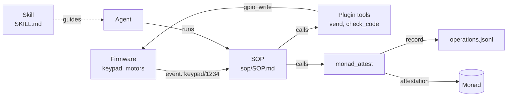

Out of the box, a KineticVM device has an identity, a vault, Telegram, and generic hardware tools. What makes it a vending machine, a soil probe, or a robot arm is what a builder adds on top.

## The building blocks

<CardGroup cols={2}>
  <Card title="Plugins" icon="puzzle" href="/build/plugins">
    **Code.** WebAssembly components that add tools to the agent, such as `vend`, `read_soil`, or `move_arm`. Sandboxed, with permissions and network egress granted per package.
  </Card>
  <Card title="SOPs" icon="list-ordered" href="/build/sops">
    **Procedure.** Standard operating procedures: triggered, ordered steps that call tools, with approvals, branching, and retries. This is where an operation is defined.
  </Card>
  <Card title="Skills" icon="book-open" href="/build/skills">
    **Guidance.** Markdown instructions the model reads. They explain how and when to use your tools, without being code.
  </Card>
  <Card title="Firmware" icon="microchip" href="/build/hardware">
    **The physical side.** A microcontroller speaking JSON over serial. It drives pins and sends events, such as a keypad entry, that start procedures.
  </Card>
</CardGroup>

## How they fit together



A typical machine works like this: the firmware notices something happened and sends an event, a SOP triggered by that event runs a fixed sequence of plugin tools, and the final step calls `monad_attest` with a structured record. The skill sits beside all of it so that when a person asks the machine something in Telegram, the model knows which tools to use.

## One package, one machine

A builder ships all of this as one **plugin package**. `kinetic plugin create` writes the full layout:

<Tree>
  <Tree.Folder name="vending" defaultOpen>
    <Tree.File name="Cargo.toml" />
    <Tree.File name="manifest.toml" />
    <Tree.File name="records.example.toml" />
    <Tree.Folder name="src" defaultOpen>
      <Tree.File name="lib.rs" />
    </Tree.Folder>
    <Tree.Folder name="sop" defaultOpen>
      <Tree.File name="SOP.toml" />
      <Tree.File name="SOP.md" />
    </Tree.Folder>
    <Tree.Folder name="skills" defaultOpen>
      <Tree.Folder name="vending" defaultOpen>
        <Tree.File name="SKILL.md" />
      </Tree.Folder>
    </Tree.Folder>
    <Tree.Folder name="wit">
      <Tree.Folder name="v0" />
    </Tree.Folder>
  </Tree.Folder>
</Tree>

| Path | Role |
| --- | --- |
| `src/lib.rs`, `Cargo.toml` | The tools, compiled to `plugin.wasm` |
| `manifest.toml` | Name, version, capabilities, permissions, declared egress |
| `sop/` | The procedure, installed into the device's SOP directory |
| `skills/<name>/SKILL.md` | Guidance for the model |
| `records.example.toml` | The [operation record](/concepts/records) schema, written into the device config at install |
| `wit/v0/` | The host interface the component compiles against |

One command installs everything onto a device:

```bash
kinetic build ./vending
kinetic plugin install ./vending
```

## Where to start

<Steps>
  <Step title="Design the record">
    Decide what one completed operation looks like, field by field. This becomes `records.example.toml`, and it is what you will eventually sell. See [Operation records](/concepts/records).
  </Step>
  <Step title="Write the tools">
    One tool per physical or business action. Keep them small and deterministic. See [Plugins](/build/plugins).
  </Step>
  <Step title="Write the procedure">
    Order the tools, add approvals where a person must confirm, and end with `monad_attest`. See [SOPs](/build/sops).
  </Step>
  <Step title="Connect the hardware">
    Flash a board, wire the event that starts the procedure. See [Hardware and firmware](/build/hardware).
  </Step>
</Steps>

<Tip>
  The [vending machine tutorial](/tutorials/vending-machine) builds a complete package end to end, and the [first plugin tutorial](/tutorials/first-plugin) covers just the tool side.
</Tip>
