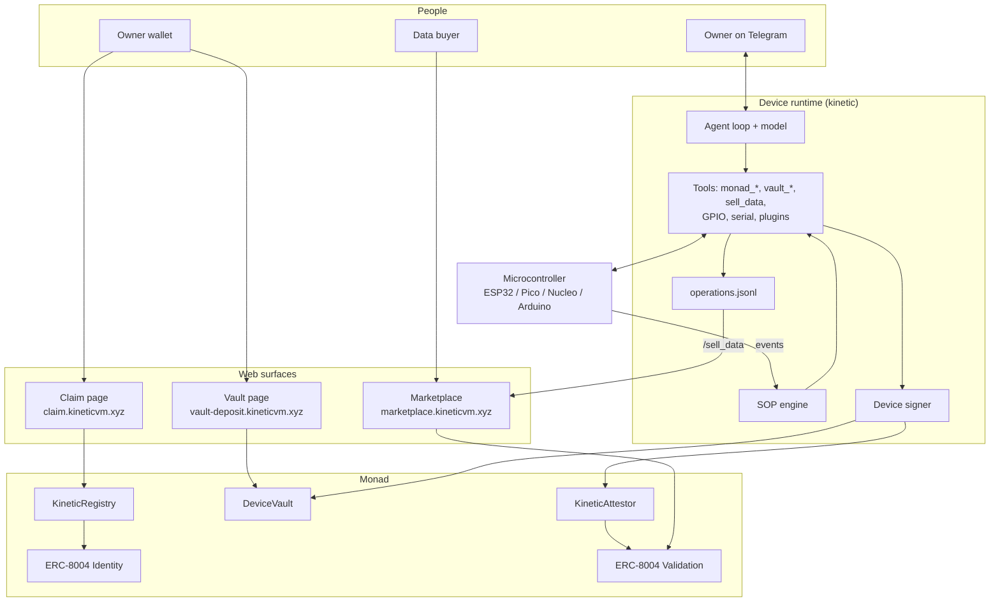

KineticVM has three layers. The **device runtime** runs on the machine. The **contracts** on Monad hold identity, money, and records. The **web surfaces** let humans claim devices, fund vaults, and trade data. Each layer has one job, and authority flows in one direction: from the owner's wallet, through the contracts, to the device.

## The device runtime

The runtime is a single Rust binary, `kinetic`. On a device it runs as one long-lived process, `kinetic start`, which brings up:

<AccordionGroup>
  <Accordion title="Agent loop" icon="brain">
    A language model with a set of tools. The default autonomy is **supervised**: medium-risk actions need approval and high-risk actions are blocked. Workspace boundaries and a command allowlist sit in front of the shell. Supported providers are Anthropic, OpenAI, Gemini, OpenRouter, Ollama, Hailo-Ollama, and any OpenAI-compatible endpoint.
  </Accordion>
  <Accordion title="Device signer and chain client" icon="key-round">
    A secp256k1 key generated on the device the first time the chain is opened, stored encrypted in `device.key` beside the config, and never logged or exported. The signer sits behind one interface so a secure element (NXP SE050) can replace the software key without changing anything above it. The chain client signs digests that the contracts compute and submits transactions from the device key.
  </Accordion>
  <Accordion title="Channels" icon="radio">
    Telegram for the owner and for customers. MQTT, webhooks, and filesystem events for machines and SOP triggers. ACP for editor clients. An HTTP and WebSocket gateway for local clients.
  </Accordion>
  <Accordion title="Hardware" icon="circuit-board">
    GPIO on Raspberry Pi, and a JSON-over-serial protocol for ESP32, Pico, Nucleo, and Arduino boards. Boards can push events, such as a keypad code, that start a procedure.
  </Accordion>
  <Accordion title="Builder extensions" icon="blocks">
    WebAssembly [plugins](/build/plugins) that add tools, [SOPs](/build/sops) that run procedures when events arrive, and [skills](/build/skills) that teach the model how to use them.
  </Accordion>
</AccordionGroup>

## The contracts

Three KineticVM contracts sit on top of two canonical ERC-8004 registries. They are **one shared installation**: every device uses the same three addresses. Claiming a device does not deploy anything.

| Contract | Responsibility |
| --- | --- |
| [`KineticRegistry`](/contracts/kinetic-registry) | Mints the agent identity to the owner, binds one device key to it, and stops that binding the moment the NFT changes hands. |
| [`DeviceVault`](/contracts/device-vault) | Holds MON per agent and releases it only to allowlisted recipients, inside caps. |
| [`KineticAttestor`](/contracts/kinetic-attestor) | Verifies device-signed action proofs and records them as ERC-8004 validations. |
| [ERC-8004 Identity](/contracts/erc-8004) | The agent NFT. `ownerOf` is the owner, always read live. |
| [ERC-8004 Validation](/contracts/erc-8004) | The public, queryable record of every attestation. |

Addresses are on the [Deployments](/contracts/deployments) page.

## The lifecycle of a device

<Steps>
  <Step title="Install and configure">
    `kinetic quickstart` stores the device name, the owner wallet, the Telegram bot, the model, and the starting caps. No key exists yet.
  </Step>
  <Step title="Pair">
    `kinetic start` prints a one-time code. The owner sends `/bind <code>` to the bot. That chat becomes the owner chat.
  </Step>
  <Step title="Create the key and sign a claim ticket">
    The device generates its key and signs an EIP-712 `ClaimTicket(device, owner, nonce, deadline)`. The ticket proves the device holds the key and names exactly one owner. It expires within a day.
  </Step>
  <Step title="Claim">
    The owner opens the claim link and calls `claim`. The registry mints the ERC-8004 identity, transfers it to the owner, binds the device, and initializes the vault caps. The owner approves the attestor as an operator on the NFT, and sends the device its first gas.
  </Step>
  <Step title="Fund">
    Anyone can deposit MON into the agent's vault account. Only the owner can withdraw.
  </Step>
  <Step title="Operate">
    The agent acts through tools. Successful actuator calls are attested automatically. Builder-defined operations are attested through `monad_attest` and appended to the local operations file. Payments go through `vault_pay`, which calls `DeviceVault.pay`. When the device's own gas runs low, it tops itself up from the vault, inside the caps.
  </Step>
  <Step title="Govern">
    The owner tightens limits or pauses from their wallet, and loosens limits, adds recipients, or unpauses by signing an EIP-712 message that the device relays. Every owner command re-reads the chain.
  </Step>
  <Step title="Monetize">
    `/sell_data` lists the attested operation records on the marketplace. Buyers verify each row against Monad, pay the owner, and download the file.
  </Step>
  <Step title="Transfer, revoke, or rotate">
    Selling the NFT moves the machine. Revoking drops the device key. Rotating swaps in a new key. See [Ownership](/operate/ownership).
  </Step>
</Steps>

## Who can do what

The table below is the core of the security model. Every row is enforced by a contract, not by the runtime.

| Action | Owner wallet | Device key | Anyone |
| --- | :---: | :---: | :---: |
| Claim or link a device to an agent | ✅ | Signs the ticket | |
| Deposit into the vault | ✅ | ✅ | ✅ |
| Pay an allowlisted recipient within caps | | ✅ | |
| Top up device gas within caps | ✅ | ✅ (up to 5 MON held) | |
| Tighten caps, pause, remove a recipient | ✅ | | |
| Loosen caps, add a recipient, unpause | ✅ | Relays the owner's signature | Relays the owner's signature |
| Withdraw from the vault | ✅ | | |
| Sign an action proof | | ✅ | |
| Submit a signed action proof | ✅ | ✅ | ✅ |
| Rotate or revoke the device key | ✅ | | |
| Release a device after an NFT transfer | ✅ | ✅ | ✅ |

<Note>
  "Owner" always means the current `ownerOf` on the ERC-8004 Identity Registry. No contract caches it. If the NFT moves, authority moves with it on the next block.
</Note>

## Where to go next

<CardGroup cols={2}>
  <Card title="Identity" icon="fingerprint" href="/concepts/identity">
    Claim tickets, binding, and what happens on transfer.
  </Card>
  <Card title="Device Vault" icon="vault" href="/concepts/vault">
    Caps, the daily window, allowlists, and signed loosening.
  </Card>
</CardGroup>
