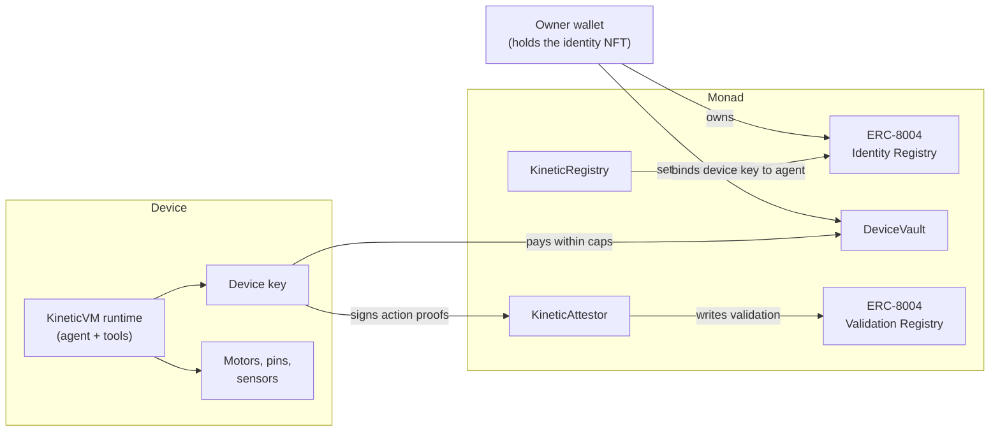

<Frame>
  
</Frame>

KineticVM is infrastructure for **physical AI**: robots, drones, vending machines, sensors, chargers, and any other machine where an AI model drives real hardware. It gives each machine three things it has never had:

<Columns cols={3}>
  <Card title="An identity someone owns" icon="fingerprint" href="/concepts/identity">
    Every machine is an [ERC-8004](/contracts/erc-8004) agent on Monad. The identity is an NFT in the owner's wallet. Owning the NFT means owning the machine.
  </Card>
  <Card title="A wallet with hard limits" icon="vault" href="/concepts/vault">
    The machine pays from a vault with a per-transaction cap, a rolling daily cap, a recipient allowlist, and a pause switch. The contract enforces every limit.
  </Card>
  <Card title="A history anyone can check" icon="badge-check" href="/concepts/attestations">
    When the machine acts, a key bound to the device signs the record and it lands on Monad as an attestation that anyone can verify.
  </Card>
</Columns>

The agent runtime that runs on the device connects a language model to the hardware, listens to its owner over Telegram, and lets builders add their own business logic as sandboxed plugins. A [data marketplace](/marketplace/overview) on top lets owners sell the machine's attested operation records, and lets buyers check every row onchain before they pay.

## The problem

AI models can now see, decide, and move. They are leaving the screen and taking over machines in kitchens, warehouses, fields, and streets. The infrastructure around those machines has not caught up. Three gaps show up as soon as an AI-driven machine leaves the lab.

<AccordionGroup>
  <Accordion title="Nobody can prove which machine did what, or who owns it" icon="circle-help" defaultOpen>
    A machine's identity today is a serial number in a vendor database, or an API key on a server. Neither can be checked by a third party, and neither says who is responsible for the machine. When a machine is sold, its history stays behind with the old vendor, or it is simply lost.

    Without a portable, ownable identity, a machine cannot build a reputation, cannot be held to account, and cannot be traded as an asset with its history attached.
  </Accordion>
  <Accordion title="Giving a machine money is all or nothing" icon="wallet">
    An autonomous machine needs to pay for things: electricity, parts, services, gas for its own transactions. The common answer is to put a private key on the device and fund it. That key can then spend everything it holds, on anything, at any time.

    A compromised device, a buggy prompt, or a model that misreads an instruction can drain it. Owners need a way to let a machine spend that is bounded by rules the machine itself cannot change.
  </Accordion>
  <Accordion title="Machine data has no provenance" icon="database">
    Every vend, pick, weld, flight, and soil reading is valuable data. Operators, insurers, regulators, and AI labs training robotics models all want it. But a log file on a server is just a claim. Anyone can edit it, and a buyer has no way to tell a real record from a fabricated one.

    Without provenance, machine data cannot be priced, audited, or trusted. It stays locked inside the company that collected it.
  </Accordion>
</AccordionGroup>

## How KineticVM solves it

KineticVM separates **who owns the machine** from **the key the machine uses**, and puts the rules between them on Monad.

<Steps>
  <Step title="The owner holds the identity">
    Claiming a device mints an ERC-8004 agent NFT straight into the owner's wallet. The device signs a claim ticket that proves it holds its key and names that owner. The device key is never the NFT owner and never an operator on it. See [Identity](/concepts/identity).
  </Step>
  <Step title="The device spends only inside the vault">
    The owner deposits MON into a [DeviceVault](/concepts/vault) account for that agent. The device can pay an allowlisted recipient, and only inside the per-transaction and daily caps. Tightening a limit is instant. Loosening one, adding a recipient, or unpausing needs the owner's wallet signature, so a compromised device cannot raise its own limits.
  </Step>
  <Step title="Every action becomes a signed record">
    After a successful actuator action, or a completed operation the builder defines, the device key signs an EIP-712 `ActionProof`. The [KineticAttestor](/concepts/attestations) verifies that signature against the key bound to the agent and writes the result to the ERC-8004 Validation Registry, where anyone can read it.
  </Step>
  <Step title="The records become a dataset">
    The device keeps the exact bytes it signed in a local [operations file](/concepts/records). The owner can list those records on the [marketplace](/marketplace/overview), and a buyer can rehash any row and match it against the attestation on Monad before paying.
  </Step>
</Steps>

<Tip>
  **A tokenized machine.** Because the machine's identity is an NFT the owner holds, transferring the NFT transfers control of the machine. The moment `ownerOf` changes, the old device binding stops working, spending stops, and the new owner links the device to themselves. The machine's entire attested history follows the identity. See [Ownership](/operate/ownership).
</Tip>

## What is in the stack

<CardGroup cols={2}>
  <Card title="Smart contracts" icon="file-code" href="/contracts/overview">
    `KineticRegistry`, `DeviceVault`, and `KineticAttestor` on Monad, built on the canonical ERC-8004 Identity and Validation registries. One shared deployment serves every device.
  </Card>
  <Card title="Device runtime" icon="cpu" href="/how-it-works">
    A single Rust binary, `kinetic`, for 64-bit Linux (including Raspberry Pi) and macOS. It runs the agent loop, the device key, the chain client, Telegram, and the hardware adapters.
  </Card>
  <Card title="Builder toolkit" icon="blocks" href="/build/overview">
    Sandboxed WebAssembly [plugins](/build/plugins), event-driven [SOPs](/build/sops), and [skills](/build/skills). A builder writes the business logic; the host keeps the key, the vault, and the attestations.
  </Card>
  <Card title="Web surfaces" icon="globe" href="/marketplace/overview">
    The claim page at `claim.kineticvm.xyz`, the vault deposit page, and the data marketplace at `marketplace.kineticvm.xyz`.
  </Card>
</CardGroup>

## Who KineticVM is for

<Tabs>
  <Tab title="Machine owners" icon="user">
    You own one machine or a fleet. You want each one to run on its own, pay for what it needs inside limits you set, and report to you on your phone. You want its records to be worth something.

    Start with the [Quickstart](/quickstart), then read [Operating a device](/operate/telegram).
  </Tab>
  <Tab title="Device builders" icon="wrench">
    You build machines or the software that runs them: a vending controller, a robot arm cell, a soil sensor network. You want an identity, a wallet, and provenance without writing smart contracts or key management.

    You do not deploy contracts. You install the binary, write a [plugin package](/build/overview), and ship. Start with [Building on KineticVM](/build/overview).
  </Tab>
  <Tab title="Data buyers" icon="search">
    You train robotics models, underwrite machines, audit operators, or study demand. You want machine data with a provable source.

    Every row on the marketplace is tied to an onchain attestation you can check yourself. Start with [Buyer verification](/marketplace/verification).
  </Tab>
</Tabs>

## Design principles

<AccordionGroup>
  <Accordion title="The chain is the source of truth" icon="link">
    Device identity, the owner, vault limits, and revocation live onchain. The device reads them when it needs them and keeps no authoritative copy. If anything local disagrees with the chain, the chain wins. See [State](/concepts/state).
  </Accordion>
  <Accordion title="The device key has the least authority that works" icon="key-round">
    The device key can pay inside the limits, top up its own gas inside the limits, sign attestations, and relay a change the owner already signed. It cannot own the identity, approve operators, raise a cap, add a recipient, unpause, or withdraw.
  </Accordion>
  <Accordion title="There is no path around the vault" icon="shield">
    Every transfer of value from the vault to a third party goes through one function, `pay`, which checks the pause flag, the allowlist, the per-transaction cap, the daily window, and the balance. Even the device's own gas top-up counts against the caps.
  </Accordion>
  <Accordion title="Honest about what a signature proves" icon="scale">
    An attestation proves that the device key bound to an agent signed a specific record at a specific time. It does not, by itself, prove that a motor physically turned. KineticVM says so plainly, and makes the signed record as precise and checkable as possible. See [Attestations](/concepts/attestations#what-an-attestation-proves).
  </Accordion>
</AccordionGroup>

## Project status

<Warning>
  KineticVM runs on **Monad testnet** (chain id `10143`). The contracts are not upgradeable, have no global pause, and have **not been externally audited**. The runtime refuses to use Monad mainnet until a mainnet deployment exists. Do not put funds you cannot afford to lose behind a device.
</Warning>

The agent runtime is a modified fork of [ZeroClaw](https://github.com/zeroclaw-labs/zeroclaw), dual-licensed MIT or Apache-2.0. KineticVM is not the official ZeroClaw project. See `NOTICE` in the repository.

## Read the docs like a book

Each chapter builds on the one before it.

<CardGroup cols={3}>
  <Card title="1. Get started" icon="rocket" href="/quickstart">
    Install, claim, and fund a device.
  </Card>
  <Card title="2. Core protocol" icon="layers" href="/concepts/identity">
    Identity, vault, attestations, state, and records.
  </Card>
  <Card title="3. Operate" icon="smartphone" href="/operate/telegram">
    Run a device from Telegram and your wallet.
  </Card>
  <Card title="4. Build" icon="blocks" href="/build/overview">
    Plugins, SOPs, skills, and hardware.
  </Card>
  <Card title="5. Marketplace" icon="store" href="/marketplace/overview">
    List records and verify datasets.
  </Card>
  <Card title="6. Contracts" icon="file-code" href="/contracts/overview">
    Every function, event, and address.
  </Card>
</CardGroup>
