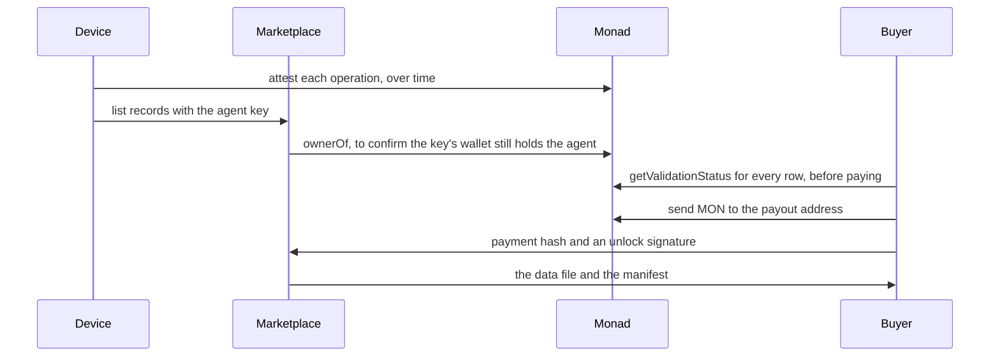

The marketplace at [marketplace.kineticvm.xyz](https://marketplace.kineticvm.xyz) is where a machine's [operation records](/concepts/records) become a dataset someone else can buy. The device never uploads a private key. It uploads two files whose rows point at attestations on Monad, and anyone can check those pointers before paying.

<Columns cols={2}>
  <Card title="The seller" icon="cpu">
    The owner of an agent NFT. They pair Telegram, set a marketplace key, and tell the device to list. Payment goes to their wallet.
  </Card>
  <Card title="The buyer" icon="search">
    Anyone with a marketplace account. They can check every row against the Validation Registry before they pay, and they receive the files only after a confirmed payment.
  </Card>
</Columns>

## What a listing is

A listing is two files pinned to IPFS, plus a public page:

| File | What it holds | Who can read it before payment |
| --- | --- | --- |
| `manifest.json` | One row per operation: `paramsHash` and `requestHash` | The verify endpoint, so a buyer can check the chain without seeing the data |
| `operations.jsonl` | The canonical record lines the device signed | Nobody. The CID is not in the listing response |

The public page shows the title, summary, machine type, license, price, row count, and field names. It does not show the records.

## Accounts and keys

Buyers and sellers sign in with Google. An account is not enough to publish for an agent. Publishing from a device needs an **agent API key**:

<Steps>
  <Step title="Sign in">
    Open the marketplace and sign in.
  </Step>
  <Step title="Prove the wallet">
    From the account keys page, pick the agent id and sign this message with the wallet that holds the NFT. It is a personal signature, not EIP-712:

    ```text
    KineticVM marketplace
    Issue agent key
    wallet: 0x6477…7f77
    chain: 10143
    agent: 2005
    nonce: …
    ```
  </Step>
  <Step title="Receive the key">
    The marketplace reads `ownerOf` on the Identity Registry. If the signer is the owner, it returns a secret that starts with `kvm_`. That secret is shown once.
  </Step>
  <Step title="Store it on the device">
    ```bash
    kinetic config set marketplace.key
    ```

    The value is stored encrypted. The device sends it as `Authorization: Bearer kvm_…` and never prints it back.
  </Step>
</Steps>

<Warning>
  A key is bound to the wallet that held the agent when it was issued. If the NFT moves, the marketplace revokes keys whose wallet is no longer `ownerOf`, both when a new key is requested and when a listing is published.
</Warning>

Payouts go to the wallet that holds the agent, or to an address the owner saved in marketplace settings. A listing cannot name an arbitrary third address.

## The three moments that touch the chain



Listing and verification are covered on the next two pages. Nothing on the marketplace can create an attestation. A buyer confirms each row on chain before paying, and a row the device never signed fails that check.
