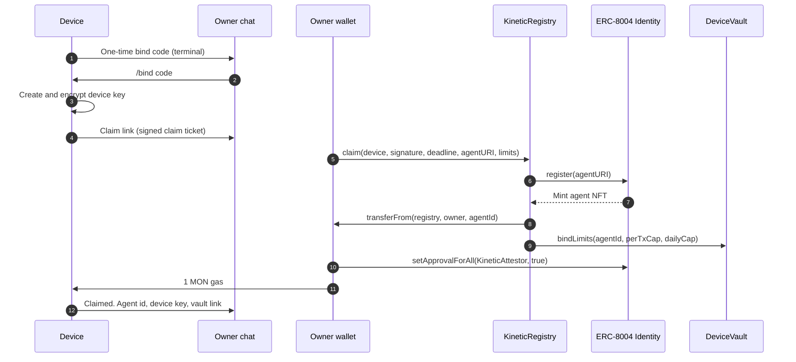

By the end of this page you will have a device that:

- holds its own signing key,
- is claimed as an ERC-8004 agent whose NFT sits in **your** wallet,
- has a funded vault with spending caps you chose,
- answers you on Telegram and records its actions on Monad.

The device can be a Raspberry Pi, any 64-bit Linux machine, or a Mac. Hardware such as an ESP32 is optional for this page; [Hardware and firmware](/build/hardware) covers it.

## Before you start

<CardGroup cols={2}>
  <Card title="A machine to run on" icon="cpu">
    64-bit Linux (x86_64 or aarch64) or macOS (Apple Silicon or Intel). On a Raspberry Pi, use the **64-bit** Raspberry Pi OS image.
  </Card>
  <Card title="An owner wallet with testnet MON" icon="wallet">
    MetaMask or any EVM wallet on **Monad testnet** (chain id `10143`). You need a few MON for the claim, 1 MON of starting gas for the device, and whatever you deposit into the vault. Get testnet MON from the [Monad faucet](https://faucet.monad.xyz).
  </Card>
  <Card title="A Telegram bot token" icon="send">
    Open [@BotFather](https://t.me/BotFather) in Telegram, send `/newbot`, and copy the token it returns. This bot becomes the device's voice.
  </Card>
  <Card title="A model provider" icon="brain">
    An API key for Anthropic, OpenAI, Gemini, or OpenRouter, or a local Ollama install. Any OpenAI-compatible endpoint also works.
  </Card>
</CardGroup>

<Note>
  You do **not** deploy any contracts. Every device uses the shared KineticVM deployment on Monad testnet. See [Deployments](/contracts/deployments).
</Note>

## Set up the device

<Steps>
  <Step title="Install the binary" icon="download">
    Run the installer on the device.

    ```bash
    curl -fsSL https://raw.githubusercontent.com/kineticVM-labs/kinetic-vm/main/install.sh | sh
    ```

    The installer downloads the latest release for your platform, checks it against the published `SHA256SUMS`, and puts `kinetic` in `~/.local/bin`. Make sure that directory is on your `PATH`, then confirm:

    ```bash
    kinetic --version
    ```

    <Accordion title="Installer options">
      | Variable | Effect |
      | --- | --- |
      | `KINETIC_VERSION=v0.8.13` | Install a specific release tag instead of the latest. |
      | `KINETIC_INSTALL_DIR=/usr/local/bin` | Install somewhere other than `~/.local/bin`. |
      | `KINETIC_REPO=owner/repo` | Install from a fork's releases. |

      To build from source instead, clone the repository and run `cargo build --release` with Rust 1.96. The binary is `target/release/kinetic`.
    </Accordion>
  </Step>

  <Step title="Run quickstart" icon="list-checks">
    ```bash
    kinetic quickstart
    ```

    Quickstart is interactive and needs a terminal. It asks for eight answers:

    | Prompt | What to enter |
    | --- | --- |
    | **Device name** | A human name, such as `Lobby vending machine`. It becomes the agent's name onchain. |
    | **Owner wallet address** | The wallet that will hold the identity NFT. Use the wallet you will claim with. |
    | **Telegram bot token** | The token from BotFather. |
    | **Model provider** | `anthropic`, `openai`, `gemini`, `openrouter`, `ollama`, or `custom`. |
    | **Model** | A model id, such as `claude-sonnet-4-20250514`. |
    | **API key** | The provider key. Not needed for local providers. |
    | **Per-transaction cap (MON)** | The most the device may pay in one transaction. Default `0.05`. |
    | **Daily cap (MON)** | The most the device may spend in a rolling 24 hours. Default `1`. |

    The per-transaction cap cannot be higher than the daily cap. Quickstart writes `~/.kinetic/config.toml` (or the directory in `KINETIC_CONFIG_DIR`), turns on the `[chain]` section, and creates an agent with the alias `device`.

    <Info>
      Quickstart does **not** create the device key yet. The key is created the first time the device needs the chain, which is right after you pair Telegram in the next steps.
    </Info>
  </Step>

  <Step title="Start the runtime" icon="play">
    ```bash
    kinetic start
    ```

    The KineticVM mark prints, the gateway and channels come up, and because no Telegram account is paired yet, the terminal shows a one-time code:

    ```text
    🔐 Telegram pairing required. One-time bind code: 482913
       Send `/bind <code>` from your Telegram account.
    ```
  </Step>

  <Step title="Pair your Telegram account" icon="message-circle">
    Open a chat with your bot and send the code:

    ```text
    /bind 482913
    ```

    The terminal prints `✅ Telegram paired successfully!`. That chat is now the **owner chat**: the only chat allowed to run [owner commands](/operate/telegram).

    Right after pairing, the device creates its signing key, encrypts it on disk, signs a claim ticket naming your owner wallet, and sends a **Claim** message to the chat with two buttons: **Open in browser** and **Open in MetaMask**.
  </Step>

  <Step title="Claim the device" icon="badge-check">
    Tap a button and connect the owner wallet you entered in quickstart. The claim page at `claim.kineticvm.xyz` walks you through up to three confirmations:

    1. **`claim`** on `KineticRegistry`. This mints the ERC-8004 identity, moves the NFT to your wallet, binds the device key, and sets the starting caps.
    2. **`setApprovalForAll`** on the Identity Registry, approving the `KineticAttestor` contract (never the device) so it can write attestations for your agent.
    3. **A 1 MON gas transfer** to the device address, only if the device holds less than 1 MON. The device needs gas to send its own transactions.

    The page never sees the device key. When the claim lands, the terminal shows:

    ```text
    ✅ Lobby vending machine is claimed on Monad.
    Agent 2005
    Agent key: 0x5c7e…91a2
    Vault: 0x7710…4EE5
    ```

    <Warning>
      The claim ticket is valid for 23 hours, inside the contract's one-day limit. If it expires, restart `kinetic start` or run `kinetic claim-link` to get a fresh link.
    </Warning>
  </Step>

  <Step title="Fund the vault" icon="piggy-bank">
    Telegram also receives a **Device Vault** link. Open it, connect any wallet, and deposit MON. You can always get the link again with `/deposit`.

    The vault holds the device's spending money, separately from the device's gas. The device can only reach it through the caps, and the owner can [withdraw](/operate/funding#withdraw) at any time.
  </Step>

  <Step title="Check that everything is live" icon="circle-check">
    In the owner chat, send:

    ```text
    /status
    ```

    The reply shows the agent id, device address, owner, vault balance, what has been spent today, both caps, whether spending is paused, and links to the most recent attestations.

    On the device, print the device card:

    ```bash
    kinetic config get
    ```
  </Step>
</Steps>

## Talk to the device

Message the bot like any assistant. The agent can read its identity and vault with the [`monad_identity`](/reference/agent-tools#monad_identity) and [`vault_status`](/reference/agent-tools#vault_status) tools, and every successful pin or serial actuator action is signed and recorded on Monad automatically.

```text
You:    What's your vault balance?
Device: Balance 4.95 MON. Spent in this window 0.05 MON. Per-transaction cap 0.05 MON.
        Daily cap 1 MON. Paused: no.
```

You can also chat from the device's own terminal:

```bash
kinetic agent -a device
```

## Keep it running

Register the runtime with systemd (Linux) or launchd (macOS) so it starts when the machine boots and restarts if it stops:

```bash
kinetic service install
```

To update later, run `kinetic update`. It replaces the binary with the latest release after checking its checksum. Your config and device key are left in place.

## Headless setup

If you configure a device over SSH or from a script, you can skip the Telegram claim message and print the claim link directly:

```bash
kinetic config set chain.owner 0xYourOwnerWallet
kinetic claim-link
```

`claim-link` creates the device key if needed, signs the claim ticket, and prints the URL. Open it in the owner wallet. The terminal QR code, if shown, contains only `kinetic:<device address>`, never the signature.

## What just happened



## Next steps

<CardGroup cols={2}>
  <Card title="How it works" icon="workflow" href="/how-it-works">
    The full architecture and the lifecycle of a device.
  </Card>
  <Card title="Build a vending machine" icon="shopping-cart" href="/tutorials/vending-machine">
    Wire a Raspberry Pi to an ESP32 and attest every vend.
  </Card>
  <Card title="Owner commands" icon="smartphone" href="/operate/telegram">
    Pause, change limits, and approve recipients from Telegram.
  </Card>
  <Card title="Write a plugin" icon="blocks" href="/build/plugins">
    Add your own tools to the device.
  </Card>
</CardGroup>
